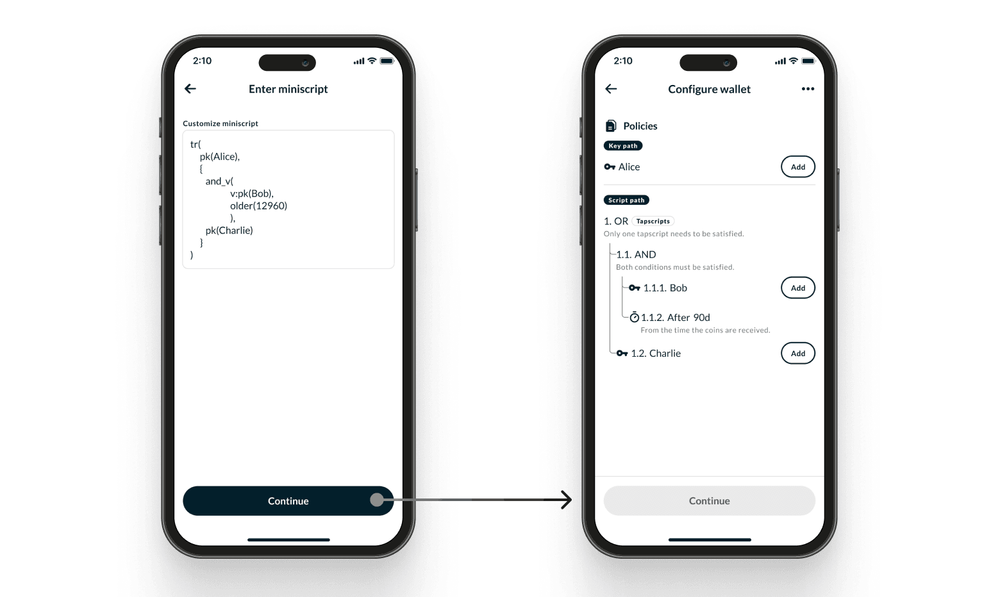

# Introduction To Smart Contracts In Bitcoin

---

## 0. Table of contents

What will be covered in this talk.

1. What is Miniscript?
2. What is it used for?
3. How do I use it?
4. Conclusion

---

## 1. What is Miniscript?

> Miniscript is a language for writing (a subset of) Bitcoin Scripts in a structured way, enabling analysis, composition, generic signing and more.
, [https://bitcoin.sipa.be/miniscript/](https://bitcoin.sipa.be/miniscript/)

Alternative definitions;

- Programming Language
- Smart Contract Language
- Scripting Language
- Policy Language

It was mainly developed by Blockstream Research

---

### 1.2 Miniscript is written as "Fragments"

Examples of Fragments are;

- `pk(A)`, checks if *public key* `A` signed transaction
- `and(A, B)`, checks if both `A` & `B` are `true`, equivalent of *and* in boolean algebra
- `older(1000)`, checks if transaction is older that `1000` *block height*
- `sha256(h)`, checks if `SHA256(x)` = `h`, equivalent to the *SHA256*  cryptographic function
  
Full list of fragments is at, [https://bitcoin.sipa.be/miniscript/](https://bitcoin.sipa.be/miniscript/)

---

### 1.3 Fragments are combined to make a "Policy"

Example Policy Combining `and()`, and `pk()`;

- `and(pk(A), pk(B))`

This policy makes sure that a transaction if *only* valid if;

- Public Key A
- Public Key B
  
Provide valid signatures.

- `pk(A)` checks  if  public key A is valid
- `pk(B)` checks  if  public key A is valid
- `and()` verifies if out puts of `pk(A)` & `pk(B)` return `true`

---

### 1.3 Policy compiles to "Bitcoin Script"

Since Bitcoin's native language is "Bitcoin Script" it can't directly read Miniscript.

The policy `and(pk(A), pk(B))`  finally compiles down to Bitcoin Script as follows;

```Bitcoin Script
<A> OP_CHECKSIGVERIFY <B> OP_CHECKSIG
```

Where;

- `A` & `B` are the respective public keys
- `OP_CHECKSIGVERIFY` & `OP_CHECKSIG` are corresponding OP Codes, [https://en.bitcoin.it/wiki/Script#Opcodes](https://en.bitcoin.it/wiki/Script#Opcodes)

---

## 2. What is it used for?

Miniscript can we used for example applications;

- Multisig Wallets (A & A)
- Shared Wallet (A or B)
- Savings wallets (nLocktime)
- Two Factor Authenticated Wallets (Hash Lock + PK)

---

## 2.2 Uses of Miniscript: `Multisig wallets`

Multisig (multiple signature) wallets are wallets that require a minimum of two signatures to create valid transactions.

```policy
and(
    pk(A), pk(B)
)
```

Policy for a multisig wallet that requires *both* signatures public key `A` and public key `B`

---

## 2.3 Uses of Miniscript: `Shared wallets`

A shared wallet is one that requires *only one* signature to withdraw funds.

```policy
or(
    pk(A), pk(B)
)
```

Illustrated by the policy above, not thar the only difference between this and  multisig is that we use `or()` instead of `and()`

---

## 2.4 Uses of Miniscript: `Savings wallet`

Savings wallets lock up money for X amount of days.

```policy
and(
    pk(A), older(12960)
)
```

- The `older()`, ensures that the transaction is only valid after `12960` blocks or 90 days
- `pk(A)` ensures only someone with public key `A` can make the transaction

---

## 2.5 Uses of Miniscript: `Two Factor Wallets`

2FA Wallets, only allow transactions if it produces *both* a valid signature by `A` and a valid secret `H`

```policy
and(
    pk(A), sha256(H)
)
```

Transaction by the policy will only be valid if you produce secret `H`, that yields valid hash.

Meaning even if your private key is compromised, an attacker without `H` can't steal your funds.

---

## 3. How to use Miniscript?

There are two reliable ways of using Miniscript

- **Rust Miniscript**, suitable for developers.
- **Nunjucks**, suitable for GUI non-technical people.

---

## 3.2.1 How to use Miniscript: `Rust Miniscript`

// create policy

```rust
let multisig_policy = Concrete::<bitcoin::PublicKey>::from_str(&format!(
    "
     and(
        pk({A}), pk({B})
     )
    ",

    A = "020202020202020202020202020202020202020202020202020202020202020202",
    B = "022222222222222222222222222222222222222222222222222222222222222222",
    ).unwrap();
 )
```

---

## 3.2.2 How to use Miniscript: `Rust Miniscript`

// compile miniscript to descriptor

```rust
let multisig_descriptor = Wsh::new(

    multisig_policy
    .compile()
    .expect("Policy compilation only fails in case of resource limits")

)
.expect("Resource limits")
```

---

## 3.2.3 How to use Miniscript: `Rust Miniscript`

// Get address for WSH descriptor

```rust
let multisig_btc_address = multisig_descriptor.address(Network::Bitcoin)

// bc1qmpfcw7he9z5d9ftfe8qw699azmm2sr8fen903fs4plv007yx0t3qxfmqv5

```

---

## 3.2 How to use Miniscript: `Nunjucks`

Nunjucks



Simply write your policy in the wallet.

---

## 4. Conclusion

The best resources if you want to learn more about Miniscript

- Learning the language, [https://nunchuk.io/blog/miniscript101](https://nunchuk.io/blog/miniscript101)
- Full reference of language, [https://bitcoin.sipa.be/miniscript/](https://bitcoin.sipa.be/miniscript/)
- Bitcoin Script documentation, [https://en.bitcoin.it/wiki/Script](https://en.bitcoin.it/wiki/Script)
- Rust Miniscript, [https://git.rust-bitcoin.org/rust-bitcoin/rust-miniscript](https://git.rust-bitcoin.org/rust-bitcoin/rust-miniscript)

Thanks!
